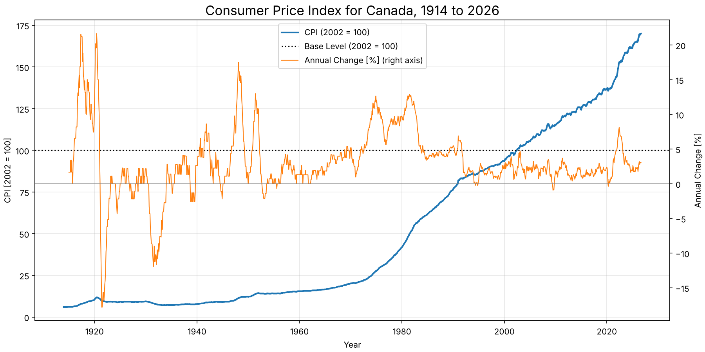

# FINE3300-2026-A2

FINE 3300 (Python for Finance Professionals), Assignment #2, Part B: a Consumer Price Index (CPI) graph and an enhanced version of the Bank of Canada Inflation Calculator, built with Python, NumPy, Pandas, Matplotlib, Visual Studio Code, Git and GitHub.

## Overview

The Consumer Price Index (CPI) measures the price level of a fixed "basket" of goods and services bought by Canadian households, such as food, shelter, transportation, clothing and recreation. Statistics Canada publishes it every month, and the change in the CPI over time is used to measure inflation.

The program does two things:

1. **CPI graph.** It reads the Bank of Canada monthly CPI data into a Pandas data frame and uses Matplotlib to graph the CPI and its annual percentage change (`CPI.png`).
2. **Inflation calculator.** It replicates the [Bank of Canada Inflation Calculator](https://www.bankofcanada.ca/rates/related/inflation-calculator/). The website only accepts a **year** for each period, even though the data is monthly. My version accepts a **month and a year** for each period (for example `1985-03`), validates every input, and produces the same results as the website.

## Repository Contents

| File | Description |
| --- | --- |
| `InflationCalculator.py` | My `InflationCalculator` class and the program that creates the graph and prompts the user |
| `BankOfCanadaCPI.2026.csv` | Bank of Canada monthly CPI data, January 1914 to September 2026 |
| `CPI.png` | Graph of the CPI and its annual percentage change, created by the program |
| `requirements.txt` | The three libraries the program needs (NumPy, Pandas and Matplotlib) |
| `README.md` | This file: project description, graph, commentary and sample output |
| `.gitignore` | Tells Git to skip Python cache and virtual environment folders |

## Data

`BankOfCanadaCPI.2026.csv` is the CSV version of the data used by the Bank of Canada Inflation Calculator ([download link](https://www.bankofcanada.ca/valet/observations/STATIC_INFLATIONCALC/csv)). The source is Statistics Canada, Consumer Price Index for Canada, all-items (series V41690973). The index is scaled so that **2002 = 100**.

The file starts with a few lines about the terms of use and the series. The data itself is under the `OBSERVATIONS` line and has two columns: the date and the CPI.

**Data cleaning:** the file has two extra rows, dated `1927-04-30` and `1932-04-30`, that repeat the May value. Every real monthly value is dated on the first of the month, so the program keeps only those rows. After cleaning, the data set has 1,353 months.

## How It Works

### The `InflationCalculator` class

- **`__init__(file_name)`** stores the file name and reads the file when the object is created.
- **`__read_file()`** is a private method. It finds the `OBSERVATIONS` line, reads the data into a Pandas data frame, removes the two extra rows, extracts the year and month of each row, and calculates the annual percentage change with NumPy arrays (the CPI from the 13th month onwards divided by the CPI 12 months before it).
- **`get_first_date()`** and **`get_last_date()`** return the first and last months in the data set.
- **`get_cpi(year, month)`** returns the CPI for a given month.
- **`validate_price(text)`** and **`validate_date(text)`** check the user's input. Like `draw_lottery()` in the Lecture #4 `Lottery.py` example, they return a pair `(valid, result)`: if the input is valid, `result` is the value; if not, it is a message that explains the problem.
- **`calculate(price, start, end)`** performs the calculations and returns the results.
- **`plot_cpi(file_name)`** creates the graph and saves it as a PNG file with `savefig()`.

The data members are private (double underscore), and the main program only uses the class through its public methods.

### Formulas

The formulas are the same ones used by the Bank of Canada calculator:

| Result | Formula |
| --- | --- |
| Price in the second period | price × (CPI₂ ÷ CPI₁) |
| Percent change | (new price − price) ÷ price × 100 |
| Number of years | months between the two dates ÷ 12 |
| Average annual rate of inflation | (CPI₂ ÷ CPI₁)^(1 ÷ number of years) − 1 |
| Annual percentage change (graph) | CPI this month ÷ CPI in the same month one year earlier - 1 |

The Bank of Canada calculator does **not** use annual averages. For both years, it uses the CPI of the **most recent month in the data** (September in the current file). For example, "1914 to 2026" compares September 1914 (6.0) with September 2026 (170.0). When a year is entered on its own, my program does the same thing, so it gives exactly the same results as the website:

| $100 from 1914 to 2026 | Bank of Canada website | My program |
| --- | --- | --- |
| Would cost | $2,833.33 | $2,833.33 CAD |
| Percent change | 2,733.33 | 2,733.33% |
| Number of years | 112 | 112.00 |
| Average annual rate | 3.03 | 3.03% |
| CPI for first / second year | 6.0 / 170.0 | 6.0 / 170.0 |

### User input and validation

The program uses `input()` to ask for the price, the date of the first period and the date of the second period. If an input is not valid, the program explains why and asks again.

- **Price:** dollar signs, commas and spaces are allowed (for example `$1,250.50`). The price must be a number greater than zero.
- **Dates:** entered as `YYYY-MM` or `YYYY/MM` (for example `1985-03`). The program extracts the year and the month, checks that the month is between 01 and 12, and checks that the date is inside the data set (January 1914 to September 2026). A year on its own (for example `1914`) is also accepted and uses the latest month in the data, like the Bank of Canada website.

The results are rounded to the nearest penny and printed with a dollar sign and the currency code (CAD).

## Requirements

Python 3 with NumPy, Pandas and Matplotlib. To install them, run:

```bash
pip install -r requirements.txt
```

## How to Run

1. Clone the repository. In Visual Studio Code, choose **File → Open Folder** and open the `FINE3300-2026-A2` folder itself, so the program can find `BankOfCanadaCPI.2026.csv`.
2. Open a terminal in VS Code (**Terminal → New Terminal**). Make sure it is in the `FINE3300-2026-A2` folder, then run:

```bash
python3 InflationCalculator.py
```

(On Windows, use `python InflationCalculator.py`.)

3. The graph opens in a new window and is saved as `CPI.png`. Close the graph window to continue.
4. Enter the price, the date of the first period and the date of the second period. Enter `Y` to do another calculation or `N` to stop.

## CPI Graph



The blue line is the CPI (left axis), the orange line is the annual percentage change (right axis), and the dotted line is the base level (2002 = 100). The grey line marks 0% on the right axis.

### Commentary

- **Prices are about 28 times higher than in 1914.** The CPI rose from 6.0 in September 1914 to 170.0 in September 2026. A basket that cost $100 in 1914 costs about $2,833 today, an average increase of 3.03% per year over 112 years.
- **The CPI crosses the base line in 2002.** This is expected, because the index is scaled so that 2002 equals 100. The 12 monthly values for 2002 average 99.99.
- **The early years were the most volatile.** Annual inflation reached about 21.6% in June 1920, after World War I, and then turned into deflation of about -17.8% by June 1921. There was another peak of about 17.5% in February 1948, after wartime price controls ended.
- **The Great Depression shows deflation.** Prices fell by as much as 12% per year (July 1931). The CPI did not return to its January 1930 level (9.4) until 1946.
- **The "Great Inflation" of the 1970s and early 1980s.** Oil price shocks pushed inflation above 10%, with a peak of about 12.9% in July 1981. This is where the CPI line becomes much steeper. Inflation then fell quickly after the Bank of Canada raised interest rates in the early 1980s.
- **Inflation targeting since 1991.** In 1991, the Bank of Canada and the federal government adopted inflation-control targets, which settled at 2% (inside a 1% to 3% range) by the mid-1990s. From 1992 to 2020, annual inflation averaged about 1.8% and was inside the 1% to 3% range about 76% of the time, which is why the orange line is much flatter in this period. The one-month jump of 2.6% in January 1991 is when the Goods and Services Tax (GST) was introduced.
- **COVID-19 and the 2022 spike.** Inflation dipped below zero in May 2020 (−0.4%), then rose to 8.1% in June 2022, the highest rate since January 1983. It has since come back down to about 3.1% (September 2026).

## Sample Output

**Month and year: $1,250.50 from March 1985 to September 2026**

```text
Enter the price of the goods or services: $1,250.50
Enter the date of the first period (YYYY-MM): 1985-03
Enter the date of the second period (YYYY-MM): 2026-09

A basket of goods and services that cost $1,250.50 CAD in March 1985
would cost $3,417.77 CAD in September 2026.

Percent change:                         173.31%
Number of years:                        41.50 (498 months)
Average annual rate of inflation (%) /
Decline in the value of money:          2.45%
CPI for first period (Mar 1985):        62.2
CPI for second period (Sep 2026):       170.0
```

**Year only (same result as the Bank of Canada website): $100 from 1914 to 2026**

```text
Enter the price of the goods or services: 100
Enter the date of the first period (YYYY-MM): 1914
Enter the date of the second period (YYYY-MM): 2026

A basket of goods and services that cost $100.00 CAD in September 1914
would cost $2,833.33 CAD in September 2026.

Percent change:                         2,733.33%
Number of years:                        112.00 (1,344 months)
Average annual rate of inflation (%) /
Decline in the value of money:          3.03%
CPI for first period (Sep 1914):        6.0
CPI for second period (Sep 2026):       170.0
```

**Going back in time: $50.00 from September 2026 to March 1991**

```text
Enter the price of the goods or services: $50.00
Enter the date of the first period (YYYY-MM): 2026-09
Enter the date of the second period (YYYY-MM): 1991-03

A basket of goods and services that cost $50.00 CAD in September 2026
would cost $24.21 CAD in March 1991.

Percent change:                         -51.59%
Number of years:                        -35.50 (-426 months)
Average annual rate of inflation (%) /
Decline in the value of money:          -2.02%
CPI for first period (Sep 2026):        170.0
CPI for second period (Mar 1991):       82.3
```

**Input validation**

```text
Enter the price of the goods or services: abc
Invalid input: the price must be a number.

Enter the price of the goods or services: -5
Invalid input: the price must be greater than zero.

Enter the price of the goods or services: 1000
Enter the date of the first period (YYYY-MM): 2030-01
Invalid input: the date must be between January 1914 and September 2026.

Enter the date of the first period (YYYY-MM): 03/1985
Invalid input: please enter the date as YYYY-MM (for example 1985-03).

Enter the date of the first period (YYYY-MM): 1985-13
Invalid input: the month must be between 01 and 12.
```

## Sources

- Bank of Canada, Inflation Calculator: https://www.bankofcanada.ca/rates/related/inflation-calculator/
- Bank of Canada, Understanding the Consumer Price Index: https://www.bankofcanada.ca/2021/05/understanding-consumer-price-index/
- Statistics Canada, Consumer price indexes: https://www.statcan.gc.ca/en/subjects-start/prices_and_price_indexes/consumer_price_indexes

## Author

Sinem Firat · FINE 3300, Schulich School of Business, York University
